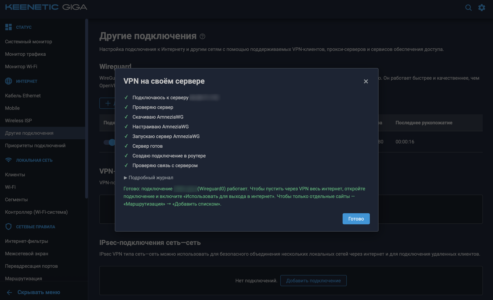
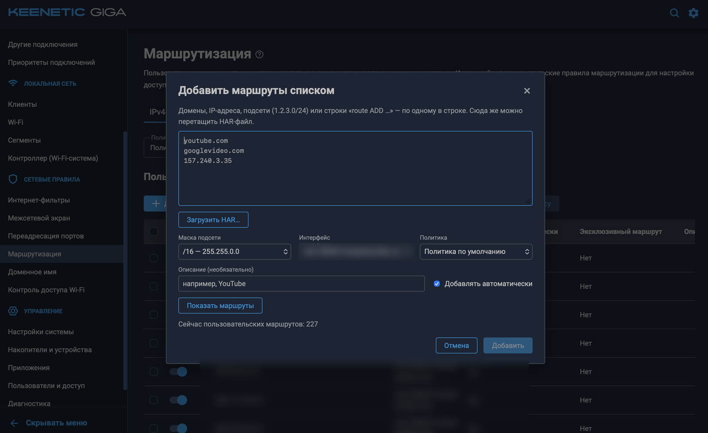

# Маршруты списком и VPN на своём сервере — для роутеров Keenetic

Дополнение к веб-интерфейсу роутеров Keenetic: четыре новые кнопки там, где их не хватало. Ставится одним
архивом через сам веб-интерфейс — без консоли, без перепрошивки и без Entware.

**Скачать** (последняя версия; архив — под процессор роутера, как выбрать — [чуть ниже](#какой-архив-скачать)):
- **[⬇ hostsgen-ui-mipsel.tar.gz](https://github.com/PavelDemyanov/keenetic-hostsgen-ui/releases/latest/download/hostsgen-ui-mipsel.tar.gz)** — большинство моделей, в том числе Giga KN-1010 и KN-1011;
- **[⬇ hostsgen-ui-aarch64.tar.gz](https://github.com/PavelDemyanov/keenetic-hostsgen-ui/releases/latest/download/hostsgen-ui-aarch64.tar.gz)** — новые модели на ARM: Giga KN-1012, Titan KN-1811, Peak KN-2710 и другие;
- **[⬇ hostsgen-ui-mips.tar.gz](https://github.com/PavelDemyanov/keenetic-hostsgen-ui/releases/latest/download/hostsgen-ui-mips.tar.gz)** — некоторые DSL-модели, например KN-2011 и KN-2111.

Все выпуски — в разделе [Releases](https://github.com/PavelDemyanov/keenetic-hostsgen-ui/releases).

| Кнопка | Где | Что делает |
|---|---|---|
| **Создать на своём сервере** | Интернет → Другие подключения | Вводите адрес и пароль арендованного сервера (VPS) — роутер сам ставит на него VPN AmneziaWG и подключается к нему. Как приложение Amnezia и в том же формате: сервер видит и приложение AmneziaVPN, а к серверу, уже настроенному в приложении, роутер подключается новым пользователем. |
| **Добавить устройство** | Там же | Подключает к тому же серверу телефон или компьютер: QR-код и файл для приложения AmneziaVPN. Там же — список всех подключений сервера и удаление ненужных. |
| **Добавить списком** | Сетевые правила → Маршрутизация | Вставляете список сайтов, IP-адресов или HAR-файл — маршруты через нужное подключение добавляются сразу, сколько угодно за раз. |
| **Сменить интерфейс** | Там же, появляется при выделении маршрутов | Отмеченные маршруты переезжают на другое подключение — например, со старого VPN на новый. |

Самый частый сценарий: **создать VPN на своём сервере** и пустить через него **только нужные сайты**
кнопкой «Добавить списком» — остальной интернет идёт напрямую, как раньше.



*«VPN на своём сервере»: вы вводите адрес и пароль сервера, а роутер сам заходит на него, ставит
и запускает AmneziaWG, создаёт подключение и проверяет связь — по шагам, как на скриншоте. Шаг «Устанавливаю
Docker» появляется, только если Docker на сервере ещё нет.*

## Что понадобится

- Роутер Keenetic с **KeeneticOS 5** (новый веб-интерфейс). Версия прошивки видна на главной странице.
- **Место для пакетов**: встроенное хранилище роутера, а если его нет — флешка, которую можно стереть.
- Для VPN — **VPS**: арендованный сервер у любого хостинга (подробнее — в разделе про VPN ниже).

## Какой архив скачать

Архив зависит от **процессора** роутера, а процессор — от **кода модели** вида KN-1011. Название модели
не подскажет: у Keenetic Giga, например, есть версии и на MIPS (KN-1011), и на ARM (KN-1012).

**Где узнать код модели:** на наклейке снизу роутера или на главной странице веб-интерфейса («Системный
монитор») в строке «Модель» — там написано, например, `Giga (KN-1011)`.

| Код модели | Процессор | Архив |
|---|---|---|
| KN-1010, KN-1011 и большинство других моделей | MIPS | `hostsgen-ui-mipsel.tar.gz` |
| KN-1012, KN-1811, KN-2710 и другие новые модели на ARM | ARM64 | `hostsgen-ui-aarch64.tar.gz` |
| KN-2011, KN-2111 и некоторые другие DSL-модели | MIPS big-endian | `hostsgen-ui-mips.tar.gz` |

**Если вашей модели в таблице нет:** нужен тот же процессор, что Keenetic называет для установки Entware.
На [support.keenetic.com](https://support.keenetic.com) откройте свою модель и статью об установке
Entware — там написано, какой архив брать: mipsel, mips или aarch64. Наш архив с тем же словом в названии.

**Если не уверены** — начните с `mipsel`. Если после установки кнопки не появились, а в журнале
(«Управление» → «Диагностика») есть строка с `exec format error`, архив не подошёл: загрузите другой
(сначала `aarch64`, потом `mips`) и повторите шаги 3–4. На роутере без Entware неподходящий архив
ничего не ломает. Если же у вас стоит Entware, берите тот же процессор, что у его установщика:
неподходящий архив остановит запуск Entware, пока вы не загрузите правильный.

## Установка — 5 шагов, только мышкой

### Шаг 1. Включите нужные компоненты

«Управление» → «Настройки системы» → «Изменить набор компонентов». Отметьте:
- **«Поддержка открытых пакетов»** (группа «Пакеты OPKG») — без неё модуль не установится;
- **«WireGuard VPN»** — нужен для кнопки «Создать на своём сервере». Если VPN не нужен, можно не ставить.

Затем установите обновление. Роутер скачает компоненты и перезагрузится — минут на 5–10 пропадёт интернет.

### Шаг 2. Выберите, куда ставить

Откройте «Управление» → «OPKG» и раскройте список «Накопитель».

- **Есть пункт «Встроенное хранилище»** — ставьте туда, флешка не нужна. Переходите к шагу 3.
- **Нет такого пункта** — вставьте флешку в USB-порт роутера, откройте «Управление» → «Накопители и
  устройства», у флешки нажмите **«Форматировать»**, выберите файловую систему **EXT4** и подтвердите.
  Всё, что было на флешке, удалится.

### Шаг 3. Загрузите архив на накопитель

«Управление» → «Накопители и устройства» → нажмите на накопитель (встроенное хранилище или флешку) —
откроется окно «Файлы и папки».

1. Нажмите первую кнопку — «Создать папку» — и назовите её `install` (маленькими латинскими буквами).
2. Щёлкните по папке `install`, чтобы выделить её, и только потом нажмите «Загрузить файл» и выберите
   скачанный архив (`hostsgen-ui-mipsel.tar.gz` или другой — по процессору).
3. Проверьте: файл должен оказаться **внутри** папки — в списке он стоит под `install` с отступом.
   Если он лёг рядом с папкой, выделите его, удалите корзиной и загрузите снова, выделив `install`.

### Шаг 4. Подключите накопитель

Роутер распаковывает архив, только когда накопитель подключают заново, — поэтому два раза «Сохранить»:

1. «Управление» → «OPKG» → «Накопитель»: выберите **«Не выбран»** → **«Сохранить»**.
2. Там же выберите накопитель, на который загружали архив, → **«Сохранить»**.

Даже если нужный накопитель уже был выбран, сделайте оба действия: иначе роутер не заметит архив.
Через пару секунд он распакуется (папка `install` исчезнет, появятся `bin`, `etc` и `share`), и роутер
встроит кнопки.

**Теперь обязательно обновите страницу браузера** (F5, на Mac — Cmd+R). Веб-интерфейс Keenetic загружается
в браузер один раз, поэтому вкладка, открытая до установки, новых кнопок не покажет, даже если ходить по
разделам меню.

### Шаг 5. Проверьте

После обновления страницы:
- «Сетевые правила» → «Маршрутизация»: рядом с «Добавить» появилась **«Добавить списком»**;
- «Интернет» → «Другие подключения»: в блоке WireGuard рядом с «Загрузить из файла» появилась
  **«Создать на своём сервере»**.

Кнопок нет — смотрите раздел [«Если что-то не получилось»](#если-что-то-не-получилось).

### Если на роутере уже есть Entware — одной командой

Тогда модуль можно поставить и обновлять по SSH, без папки `install` и переподключения накопителя.
Войдите в Entware по SSH (обычно `ssh root@192.168.1.1 -p 222`) и вставьте целиком — копируйте отсюда, а не
из мессенджера: там склеиваются строки, и скрипт перестаёт работать:

```sh
(
  url=https://github.com/PavelDemyanov/keenetic-hostsgen-ui/releases/latest/download
  # процессор — по заголовку ELF /bin/sh прошивки: по модели его не узнать
  read -r elf </bin/sh
  case "$elf" in
    "$(printf '\177ELF\002\001')"*) arch=aarch64 ;;
    "$(printf '\177ELF\001\001')"*) arch=mipsel ;;
    "$(printf '\177ELF\001\002')"*) arch=mips ;;
    *) echo "Не узнал процессор роутера"; exit 1 ;;
  esac
  # GitHub отдаёт архивы только по HTTPS, а wget из Entware его не умеет — нужен curl
  if ! command -v curl >/dev/null; then
    echo "Ставлю curl: без него архив с GitHub не скачать"
    opkg update && opkg install curl || { echo "Не удалось поставить curl — проверьте доступ к bin.entware.net"; exit 1; }
  fi
  tmp=$(mktemp -d /opt/tmp/hostsgen-ui.XXXXXX) || exit 1
  echo "Скачиваю hostsgen-ui-$arch.tar.gz"
  if curl -fsSL -o "$tmp/hg.tar.gz" "$url/hostsgen-ui-$arch.tar.gz"; then
    tar -xzf "$tmp/hg.tar.gz" -C "$tmp" &&
      mkdir -p /opt/share/hostsgen-ui &&
      cp -r "$tmp/share/hostsgen-ui/." /opt/share/hostsgen-ui/ &&
      cp "$tmp/etc/init.d/S99hostsgen-ui" /opt/etc/init.d/ &&
      /opt/etc/init.d/S99hostsgen-ui restart &&
      echo "Готово. Обновите страницу веб-интерфейса (F5, на Mac — Cmd+R) — без этого кнопки не появятся"
  else
    echo "Не скачался архив — проверьте, открывается ли github.com с роутера"
  fi
  rm -rf "$tmp"
)
```

Скрипт сам определит процессор роутера, при необходимости поставит `curl` (через `opkg`, нужен доступ
к bin.entware.net), скачает архив последней версии и перезапустит модуль — в конце
появятся строки «index.html: модуль встроен» и напоминание обновить страницу веб-интерфейса. Модуль
запускается вместе с Entware, в том числе после перезагрузки. Обновиться — выполнить ту же команду ещё раз.

## VPN на своём сервере

### Где взять сервер

Подойдёт VPS у любого хостинга — самый дешёвый тариф: 1 ядро и 1 ГБ памяти хватает с запасом.
При заказе выберите:
- **операционную систему Ubuntu** — обязательно её: проверено на Ubuntu 22.04, выбирайте её, если хостинг
  предлагает несколько версий. Debian и другие системы не поддерживаются — на них, по опыту, VPN не
  настраивается даже приложением Amnezia;
- **виртуализацию KVM**, если хостинг даёт выбор. На OpenVZ и LXC VPN не заработает;
- **процессор x86_64** (Intel или AMD) — так почти у всех тарифов; на серверах с ARM AmneziaWG в Docker нет;
- страну, через которую хотите выходить в интернет.

Сервер, уже настроенный в приложении AmneziaVPN, тоже подойдёт — на любой системе (см. [«Сервер
и приложение AmneziaVPN»](#сервер-и-приложение-amneziavpn)).

После оплаты хостинг пришлёт письмо с **IP-адресом сервера** и **паролем пользователя root** — это всё,
что нужно. Ничего настраивать на сервере не надо.

### Как создать подключение

1. «Интернет» → «Другие подключения» → в блоке WireGuard нажмите **«Создать на своём сервере»**.
2. Впишите **IP-адрес сервера** и **пароль root** из письма. Логин `root` и порт `22` уже стоят — их
   обычно менять не нужно. Можно задать понятное название, например «VPN Нидерланды».
3. Нажмите **«Создать подключение»** и подождите 3–5 минут. Окно показывает, что роутер делает на
   сервере: подключается, ставит Docker и AmneziaWG, запускает VPN, создаёт подключение и проверяет связь
   (как на скриншоте в начале страницы).
4. Когда всё отмечено галочками — готово: в списке WireGuard появилось новое подключение, уже включённое.

Окно можно закрыть посреди настройки — роутер доделает её сам. Чтобы увидеть результат и создать
подключение, откройте окно снова той же кнопкой.

Пароль сервера нужен один раз: роутер не сохраняет его и не пишет в журнал.

### Что пускать через VPN

Новое подключение само по себе ничего не меняет — интернет идёт как раньше. Выберите, что через него пускать:
- **Только нужные сайты** (удобнее всего): «Маршрутизация» → «Добавить списком» → вставьте сайты →
  выберите в списке интерфейсов новое подключение. Остальной интернет пойдёт напрямую, с обычной скоростью.
- **Весь интернет**: откройте подключение в «Других подключениях», включите **«Использовать для выхода
  в интернет»** и сохраните. При необходимости поднимите его в «Приоритетах подключений».

### Ещё одно подключение к тому же серверу

Нажмите кнопку ещё раз и введите тот же сервер — ничего не переустановится, на сервере добавится ещё
одно подключение. Так можно подключить к одному VPS второй роутер — свой или, например, родителей.
Параметры маскировки у каждого подключения свои, поэтому со стороны подключения разных роутеров
не похожи друг на друга.

### Сервер и приложение AmneziaVPN

Роутер настраивает сервер так же, как приложение AmneziaVPN: тот же контейнер `amnezia-awg2`, те же файлы
и тот же список пользователей. Поэтому:
- **Сервер уже настроен в AmneziaVPN** — введите его в «Создать на своём сервере» как есть. Окно скажет,
  что на сервере уже есть AmneziaWG приложения, и добавит в него роутер новым пользователем: ничего не
  переустанавливается, у остальных пользователей связь не прерывается. В приложении роутер появится
  в списке пользователей как «Роутер Keenetic».
- **Сервер настроил роутер** — его можно добавить и в AmneziaVPN, как свой сервер: те же адрес, логин
  и пароль. Приложение найдёт на нём AmneziaWG и покажет всех пользователей — роутеры и устройства
  из «Добавить устройство»; устройства, добавленные в приложении, появятся и в окне роутера.
- **Сервер настроен модулем до версии 1.5** (в своём контейнере `keenetic-awg`) — при первом изменении
  (новый роутер, устройство или удаление подключения) он сам переходит в формат приложения. Ключи, порт
  и подключения остаются прежними, связь прерывается на несколько секунд.

Не меняйте в приложении серверные настройки AmneziaWG (порт, параметры маскировки): сохранив их,
приложение пересоздаёт сервер с новыми ключами, и все подключения — роутеров, устройств и самого
приложения — придётся создать заново.

### Телефон, компьютер и другие устройства

Один сервер спокойно тянет и роутер, и телефоны всей семьи: каждое подключение почти не нагружает его,
всё упирается в скорость и трафик тарифа. Телефон или компьютер подключаются кнопкой
**«Добавить устройство»** рядом с «Создать на своём сервере»:

1. Впишите адрес сервера и пароль root — адрес обычно подставляется сам, из подключения роутера.
   Нажмите **«Показать устройства»**: роутер зайдёт на сервер и покажет все его подключения — свой роутер,
   другие роутеры и устройства, когда каждое было на связи и сколько через него прошло трафика.
2. Введите имя, например «Телефон Паши», и нажмите **«Добавить устройство»**. Через полминуты окно
   покажет QR-код и кнопку «Скачать файл .conf».
3. Установите на телефон приложение **AmneziaVPN** (App Store, Google Play) или **AmneziaWG** и добавьте
   в нём подключение по QR-коду. На компьютере — AmneziaVPN с [amnezia.org](https://amnezia.org) и
   скачанный файл.

У каждого устройства своё подключение со своим ключом: один и тот же файл на двух устройствах не
работал бы — сервер путал бы их, и связь пропадала бы у обоих. Ненужное подключение (потеряли телефон,
больше не хотите делиться) удаляется в том же списке кнопкой «Удалить» — остальные продолжают работать.

Что важно знать:
- **QR-код и файл — это ключ к вашему VPN.** Кто их получит, тот сможет им пользоваться — отправляйте только
  тем, кому доверяете. Роутер их не сохраняет: после закрытия окна показать их снова нельзя — удалите
  устройство и добавьте заново.
- **Обычное приложение WireGuard не подойдёт:** сервер ждёт маскировку AmneziaWG.
- **Серверу на AmneziaWG 3.1** (его настраивает роутер с KeeneticOS 5.2) нужно свежее приложение: AmneziaVPN 5
  и новее — на iPhone только оно — или AmneziaWG 3.1 и новее для Android и Windows. Серверу на 2.0 нужны
  приложения версии 2.0 и новее, на 1.0 подойдёт любое.
- Устройства подключаются к уже настроенному серверу: сначала нужен роутер с «Создать на своём сервере»
  или сервер, настроенный приложением AmneziaVPN.
- Другой роутер Keenetic лучше подключать его собственной кнопкой «Создать на своём сервере», а не файлом:
  так он получит настройки под свою прошивку. Файл пригодится для роутеров других марок — например,
  ASUS с прошивкой Asuswrt-Merlin и дополнением AmneziaWG.
- Пароль сервера, как и в «Создать на своём сервере», роутер не сохраняет; пока окно открыто, его помнит
  только эта страница браузера — каждое действие в окне снова заходит на сервер.

### Какая версия AmneziaWG

Мастер сам выбирает самую новую версию, которую понимает прошивка роутера:

| Прошивка роутера | Версия AmneziaWG |
|---|---|
| KeeneticOS 5.2 (с Alpha 11) и новее | 3.1 — самая новая маскировка |
| KeeneticOS 5.1 (с Alpha 3) — 5.2 Alpha 10, в том числе вся стабильная 5.1 | 2.0 |
| прошивки постарше | 1.0 — её проще заблокировать |

Версия сервера — общая для всех его роутеров:
- к серверу можно подключить роутер с той же или более новой прошивкой. Если сервер старше роутера,
  подключение будет на версии сервера, и окно предупредит, что маскировка слабее, чем могла бы быть;
- роутер с прошивкой старше версии сервера подключить нельзя: окно сразу скажет об этом и подскажет,
  до какой версии обновить KeeneticOS.

Поэтому, если к одному серверу будут подключаться роутеры с разными прошивками — например, ваш на 5.2 и
роутер родителей на стабильной 5.1, — при первой настройке сервера выберите в разделе «Для опытных» версию
по самому старому роутеру. Окно подсказывает это заранее.

### Для опытных

Внизу окна есть свёрнутый раздел «Для опытных». Обычно его трогать не нужно: всё, что в нём можно задать,
мастер и так выбирает сам, причём случайно — свои значения у каждого сервера и у каждого роутера.
- **Версия AmneziaWG нового сервера** — по умолчанию самая новая, которую понимает прошивка; постарше —
  чтобы к серверу могли подключаться и роутеры со старыми прошивками.
- **Пакет перед рукопожатием (I1)** — похож на DNS-запрос к популярному сайту (так по умолчанию),
  случайные байты или не отправлять совсем. Есть с AmneziaWG 2.0.
- **UDP-порт VPN** на сервере — по умолчанию случайный из 20000–59999.
- **Свои параметры AmneziaWG** — строки «Параметр = значение», например из генератора конфигураций:
  `Jc`, `Jmin`, `Jmax`, `S1`–`S4`, `H1`–`H4`, `I1`–`I5`, `ContentPaddingAddition`, таймеры
  (`RekeyAfterTime` и другие), `PersistentKeepalive`, `MTU`. Можно вставить целую конфигурацию: ключи,
  адреса и прочее, что мастер создаёт сам, он пропустит.

Версия AmneziaWG, порт, `S1`–`S4` и `H1`–`H4` общие для сервера и всех его роутеров: они действуют, только
когда сервер настраивается впервые, а у уже настроенного остаются прежними. Остальное — параметры только
этого роутера. Окно проверяет параметры по выбранной версии и покажет ошибки сразу, ещё до подключения
к серверу: `S3`, `S4` и `I1`–`I5` есть с 2.0, добивка и таймеры — только в 3.1. Тег `<c>` в `I1`–`I5`
прошивка Keenetic не принимает; для 2.0 окно разрешает только `<b 0x…>`, `<r N>` и `<t>`.

## Добавить списком

1. «Сетевые правила» → «Маршрутизация» → «IPv4-маршруты» → **«Добавить списком»**.
2. Вставьте список: сайты (`youtube.com`), IP-адреса, подсети (`1.2.3.0/24`) или строки `route ADD …`
   из старых `.bat`-файлов — по одному в строке, через пробел или запятую. Ссылки целиком тоже подойдут.
3. Выберите **маску** (чем она шире, тем больше адресов захватит один маршрут — для крупных сайтов
   вроде YouTube обычно берут /16), **интерфейс** (подключение, через которое пойдут сайты) и, если нужно,
   описание → **«Показать маршруты»**.
4. Проверьте таблицу — какие маршруты новые, а какие уже есть, — и нажмите **«Добавить N маршрутов»**.



*Окно «Добавить списком»: сверху — сайты, IP-адреса и подсети по одному в строке (или перетащите сюда
HAR-файл), ниже — маска, подключение, через которое пойдут сайты, политика и описание. «Показать маршруты»
покажет, что будет добавлено, а кнопка внизу добавит всё одним нажатием.*

Сайты роутер распознаёт своим DNS, поэтому адреса будут те же, что получают устройства вашей сети.
Ограничения штатного импорта в 1024 строки здесь нет.

**Как собрать все адреса сайта (HAR-файл).** Сайт часто грузится с десятков доменов. Чтобы не искать их
вручную: откройте сайт в браузере, нажмите F12 (на Mac — Cmd+Option+I), перейдите на вкладку «Сеть»
(Network), обновите страницу и походите по сайту, затем нажмите значок загрузки «Export HAR» (или правый
клик по списку запросов → «Save all as HAR»). Перетащите этот файл в окно «Добавить списком» — модуль сам
достанет все домены и адреса серверов, лишние можно удалить из списка. HAR разбирается прямо в браузере
и никуда не отправляется.

## Сменить интерфейс

1. В таблице «Пользовательские маршруты» отметьте нужные маршруты галочками. Все сразу — галочкой
   в заголовке таблицы.
2. Рядом со штатной «Удалить выделенные» появится **«Сменить интерфейс»** — нажмите её.
3. Выберите подключение (по умолчанию предлагается другой VPN) → **«Перенести N маршрутов»**.

Меняется только интерфейс: адреса, описания и «Добавлять автоматически» остаются прежними. Переносятся
только отмеченные маршруты, которые вы добавляли сами, и только в выбранной над таблицей политике —
системные маршруты роутера кнопка не трогает. Если какой-то маршрут не удалось добавить на новое
подключение, старый возвращается на место.

## Если что-то не получилось

**Вместо веб-интерфейса белая или серая страница.** Так было на KeeneticOS 5.1 с версиями модуля до 1.2.1 —
обновите модуль (см. [«Обновление»](#обновление)). Попасть в интерфейс до обновления можно по прямому адресу
стартовой страницы: `http://192.168.1.1/index.html` (или `http://my.keenetic.net/index.html`) — там он
откроется как обычно. Ещё вариант — отключить модуль: «OPKG» → «Накопитель»: «Не выбран».

**Кнопок нет.** Сначала обновите страницу (F5, на Mac — Cmd+R): вкладка, открытая до установки, кнопок
не покажет. Не помогло — загляните в «Файлы и папки»: если архив всё ещё лежит в папке
`install`, роутер его не распаковал — повторите шаг 4 целиком, с «Не выбран». Если архив лежит не в
`install`, а рядом с ней, — вернитесь к шагу 3. Подробности — в «Управление» → «Диагностика» → журнал,
строки с `hostsgen-ui`.

**Кнопок нет, а в журнале `exec format error`.** Архив не для вашего процессора — скачайте другой
(см. [«Какой архив скачать»](#какой-архив-скачать)) и повторите шаги 3–4.

**Нет кнопки «Создать на своём сервере», а «Добавить списком» есть.** Не установлен компонент
«WireGuard VPN» — см. шаг 1.

**«Сервер не принял логин или пароль».** Проверьте пароль (его удобно скопировать из письма). Некоторые
хостинги по умолчанию запрещают вход под root по паролю или дают вход только по ключу — такой сервер
пока не поддерживается, а в панели хостинга обычно можно включить вход по паролю.

**«Нужна Ubuntu».** На сервере другая система. В панели хостинга переустановите его на Ubuntu 22.04
(обычно это кнопка «Переустановить ОС» или «Reinstall»), дождитесь письма с новым паролем и повторите.

**«Сервер не отвечает» или «не принимает SSH-подключения».** Проверьте IP-адрес и что сервер включён
в панели хостинга. Сразу после покупки серверу нужно несколько минут, чтобы запуститься.

**«На сервере нет /dev/net/tun».** Сервер на виртуализации OpenVZ или LXC — VPN на нём не заработает.
Нужен VPS на KVM; у многих хостингов это отдельный тариф.

**Подключение создано, но связи нет.** Подождите минуту и обновите страницу. Если хостинг облачный и
у него в панели есть свой межсетевой экран (группы безопасности), откройте в нём входящий UDP-порт сервера —
окно называет его в шаге «Запускаю сервер AmneziaWG» (или «Применяю настройки сервера…») и в сообщении об отсутствии
связи, а ещё его видно в колонке «Адрес и порт пира» у подключения.

**«Сервер уже работает на AmneziaWG 3.1, а прошивка этого роутера понимает только 2.0» (или 1.0).**
Сервер настраивали с роутера на более новой прошивке. Обновите KeeneticOS этого роутера до версии из
сообщения или подключите его к другому серверу. Чтобы один сервер подходил роутерам с разными
прошивками, его нужно сразу настраивать на версию самого старого из них (см. [«Какая версия
AmneziaWG»](#какая-версия-amneziawg)).

**Телефон не подключается после «Добавить устройство».** Проверьте, что стоит AmneziaVPN или AmneziaWG, а не
обычный WireGuard, и что приложение свежее (см. [«Телефон, компьютер и другие устройства»](#телефон-компьютер-и-другие-устройства)).
В списке устройств видно, выходило ли оно на связь: «ещё не подключалось» — сервер его пакетов не получал.

**«На этом сервере нет VPN AmneziaWG».** «Добавить устройство» работает только с сервером, который уже
настроен кнопкой «Создать на своём сервере» или приложением AmneziaVPN, — сначала подключите к нему роутер.

**«Процессор сервера aarch64 не подходит».** Сервер на ARM, а AmneziaWG в Docker выпускается только для
x86_64. Возьмите тариф на Intel или AMD.

**Прошивка старше 5.2.** Кнопка всё равно работает, но настроит AmneziaWG 2.0 (KeeneticOS 5.1) или 1.0
(прошивки постарше) — их проще заблокировать. Последняя версия, AmneziaWG 3.1, появилась в KeeneticOS 5.2.

**Только что добавленных маршрутов не видно.** Обновите страницу — таблица показывает сохранённые
настройки роутера и обновляется не сразу.

## Обновление

Скачайте новый архив для своего процессора, загрузите его в папку `install` (шаг 3) и переподключите
накопитель: «OPKG» → «Накопитель»: «Не выбран» → «Сохранить» → снова накопитель → «Сохранить». Если
обновляетесь с версии 1.0 и хотите VPN, поставьте ещё компонент «WireGuard VPN» (шаг 1).

Если ставили командой через Entware — выполните её ещё раз.

После обновления тоже обновите страницу браузера: до этого во вкладке работает прежняя версия модуля.

## Отключение и удаление

- **Отключить:** «OPKG» → «Накопитель»: «Не выбран» → «Сохранить». Интерфейс сразу станет обычным;
  включить обратно — выбрать накопитель снова.
- **Удалить совсем:** отключите, затем в «Файлы и папки» удалите на накопителе папку `share/hostsgen-ui`,
  файлы `etc/init.d/S99hostsgen-ui` и `etc/initrc`, а если Entware нет — ещё и `bin/sh`.
- **Если ставили командой через Entware:** отключить — `/opt/etc/init.d/S99hostsgen-ui stop` (до следующего
  запуска Entware), удалить совсем —
  `/opt/etc/init.d/S99hostsgen-ui stop && rm -rf /opt/etc/init.d/S99hostsgen-ui /opt/share/hostsgen-ui`.
- Созданные VPN-подключения и маршруты — обычные настройки роутера, они остаются и удаляются как обычно.
  На сервере VPN — это контейнер `amnezia-awg2`, как у приложения Amnezia: удалить его можно в приложении
  или командой `docker rm -f amnezia-awg2 && docker rmi amnezia-awg2`. У серверов, настроенных модулем
  до версии 1.5, — контейнер `keenetic-awg` и папка `/opt/keenetic-vpn`: `docker rm -f keenetic-awg && rm -rf /opt/keenetic-vpn`
  (после перехода в формат приложения от неё остаётся копия `/opt/keenetic-vpn.old`).

Если на накопителе уже стоит Entware, всё работает так же: модуль ставится рядом и запускается вместе с ним.

## Совместимость

- KeeneticOS 5 с новым веб-интерфейсом. Проверено на KeeneticOS 5.2: Keenetic Giga KN-1011 (MIPS, с Entware)
  и Keenetic Giga KN-1012 (ARM64, без Entware). KeeneticOS 5.1 — с версии 1.2.1: проверено на веб-интерфейсе
  из прошивки 5.1.7, на самом роутере с 5.1 — пока нет. Сборка для DSL-моделей (MIPS big-endian) на железе ещё
  не проверялась — если у вас такая модель, расскажите в
  [Issues](https://github.com/PavelDemyanov/keenetic-hostsgen-ui/issues), заработало ли.
- Флешка — в EXT4: другие файловые системы для пакетов не проверялись.
- Маршруты — только IPv4.
- AmneziaWG 3.1 — на KeeneticOS 5.2 и новее, 2.0 — на 5.1 (с Alpha 3), на прошивках постарше — 1.0.
  Версия 2.0 проверена по прошивке 5.1.7 и импортом на 5.2; на роутере с 5.1 подключение ещё не проверялось.
- VPS проверен на Ubuntu 22.04 (x86_64, KVM).
- Сервер — в формате приложения AmneziaVPN (контейнер `amnezia-awg2`; серверы AmneziaWG 1.x старых версий
  приложения — `amnezia-awg`). Проверено: сервер версии 1.4 перешёл в этот формат, подключения роутера
  и устройств продолжили работать, приложение AmneziaVPN нашло сервер и его пользователей.

## Как это работает и безопасно ли это

Прошивка не меняется. Архив ставится штатным механизмом OPKG: при подключении накопителя роутер
распаковывает его и запускает модуль. Программы с накопителя KeeneticOS запускает только через
`/opt/bin/sh`, которую обычно приносит Entware, — поэтому архив кладёт туда ссылку на наш модуль,
собранный под ваш процессор. Если Entware есть, модуль при первом же запуске возвращает его `/opt/bin/sh`
на место. Модуль кладёт в оперативную память роутера копии стартовой страницы веб-интерфейса со ссылкой
на скрипт кнопок и папки значков интерфейса с самим скриптом и подменяет ими оригиналы (`mount --bind`).
При отключении накопителя или перезагрузке без него интерфейс снова родной; после обновления прошивки
модуль сам встраивается в новую версию страницы.

Модуль не открывает портов на роутере и сам ничего не отправляет наружу. Маршруты и подключения создаются
теми же командами API роутера, что и штатные кнопки, — под вашим входом в веб-интерфейс. Домены
распознаёт небольшая программа на роутере через его собственный DNS.

VPN на своём сервере роутер настраивает только по вашей команде и только на том сервере, который вы
указали. Пароль сервера браузер передаёт роутеру не открытым текстом, роутер использует его один раз для
входа по SSH, не сохраняет и не пишет в журнал. На сервере ставятся Docker и контейнер `amnezia-awg2`
на официальном образе Amnezia (`amneziavpn/amneziawg-go`) — так же, как его ставит приложение Amnezia;
больше на сервере ничего не меняется.
Ключи подключения создаются на сервере и передаются роутеру по тому же SSH-соединению, а журнал установки
с ними роутер стирает сразу после создания подключения. Так же и с устройствами: их настройки роутер
получает от сервера, показывает QR-кодом в окне и сразу стирает у себя; на сервере остаются только
открытый ключ и имя устройства в списке пользователей.

Маскировка AmneziaWG у каждого своя, а не одинаковая у всех, как у приложения Amnezia по умолчанию,
— иначе одинаковые настройки сами становятся приметой. Параметры, по которым сервер опознаёт пакеты
(`S1`–`S4`, `H1`–`H4`, ключ защиты заголовков), выбираются случайно, когда сервер настраивается впервые.
У каждого роутера, кроме того, свои мусорные пакеты перед рукопожатием, свои таймеры и свой первый пакет:
DNS-запрос к одному из популярных сайтов в одном из нескольких вариантов. Серверы, настроенные прежними
версиями модуля, сохраняют свои общие параметры, чтобы уже подключённые роутеры не потеряли связь, а новые
подключения к ним получают свои.

## Для разработчиков

```
web/common.js           общая часть модулей: вызовы API роутера, окно, кнопки
web/addon.js            «Добавить списком» и «Сменить интерфейс»: диалоги, разбор ввода и HAR, подсети
web/vps.js              «Создать на своём сервере» и «Добавить устройство»: окна, ход настройки, импорт подключения
web/qr.js               QR-код для окна устройств (своя реализация: страница роутера не грузит чужие скрипты)
helper/hostsgen-ui.c    статическая программа: встраивание в интерфейс (start/stop), DNS (resolve), VPS (vps-*)
server/vps-setup.sh     установка AmneziaWG на VPS: выполняется там по SSH
router/S99hostsgen-ui   init-скрипт для роутеров с Entware: запускает сборку под процессор
router/initrc           сценарий запуска OPKG для накопителя без Entware
tools/pack.py           упаковка архива в формате GNU tar (иначе распаковщик прошивки его не примет)
tests/                  тесты веб-модулей и сценария сервера (node --test)
```

```bash
./build.sh                      # тесты + сборка и архивы dist/install/hostsgen-ui-{mipsel,mips,aarch64}.tar.gz
ROUTER=root@192.168.1.1 ARCH=mipsel ./deploy.sh   # выложить на роутер с Entware по SSH (порт 222)
```

Для сборки нужны Node.js, Python 3 и [Zig](https://ziglang.org) (кросс-компиляция C со статическим musl);
`build.sh` сам скачивает и собирает SSH-клиент [dropbear](https://matt.ucc.asn.au/dropbear/dropbear.html).
Подробности устройства и известные подводные камни — в [CLAUDE.md](CLAUDE.md).

## Лицензия

[MIT](LICENSE). В архив входит SSH-клиент dropbear — его лицензия (тоже MIT-подобная) лежит в пакете
рядом с ним: `share/hostsgen-ui/LICENSE.dropbear`.
